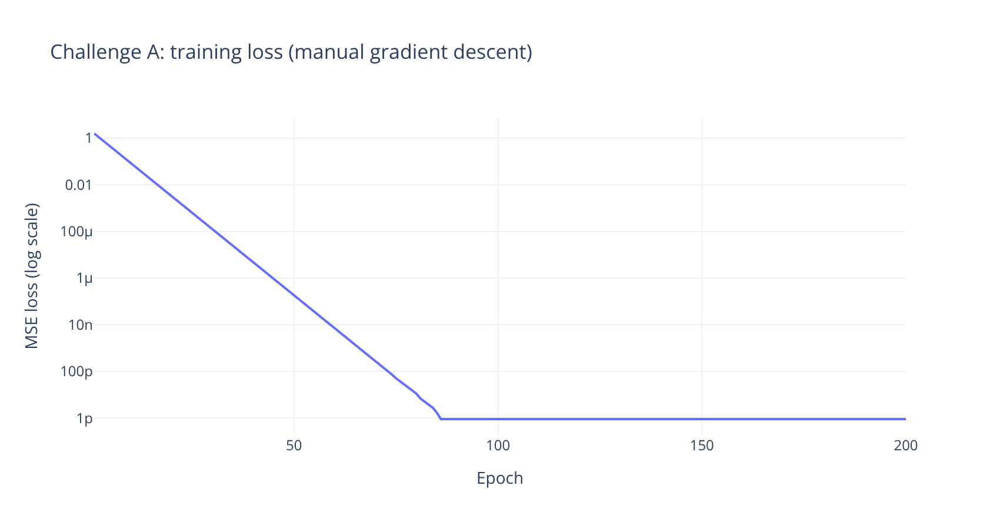
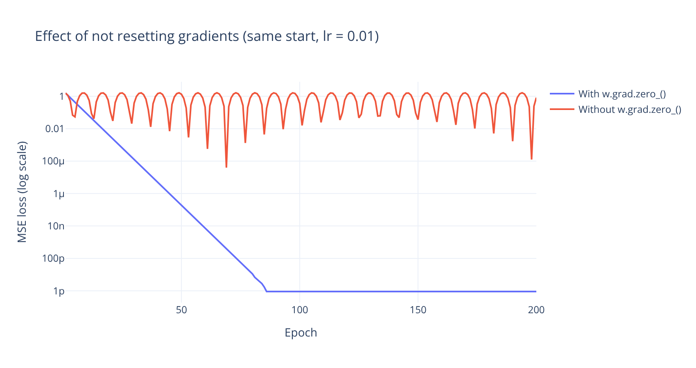
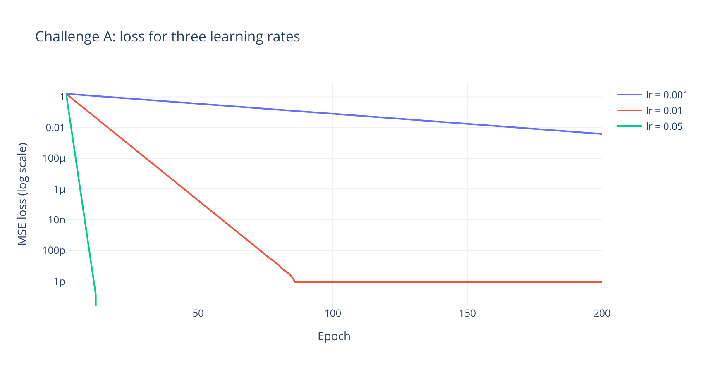

# Gradient Descent Workshop — Group 1

**Course:** CSCN8010 – Foundations of Machine Learning Frameworks (Conestoga College)
**Instructor:** Prof. David Espinosa
**Repository:** https://github.com/kinghighshow/GradientDescent_Workshop

This workshop studies gradient descent, the optimization method used to train neural networks: the mathematics behind it, and the same training logic implemented in **PyTorch**, **TensorFlow** (`tf.GradientTape`) and **Keras** (`model.fit()` and a custom training loop), followed by a reflection comparing the three frameworks.

## Team

| Member | Student ID | Part |
|---|---|---|
| Sultan Akinola Atanda | 9114837 | Mathematical understanding, merged notebook, reflections Q1–Q5, Q14–Q15 |
| Antonio Sainz | 9072844 | PyTorch implementation (Challenge A), README, reflections Q6, Q9, Q10 |
| John Buni | 9115726 | TensorFlow implementation (Challenge B + extension), submission PDF, reflections Q7, Q8, Q11 |
| Echezona (Eche) Oji | 9078881 | Keras implementation (Challenges C1, C2), requirements and reproducibility, reflections Q12, Q13 |

---

## 1. Getting started

### Prerequisites

- Python 3.12 (64-bit)
- Git
- VS Code with the Python and Jupyter extensions, or JupyterLab

### Clone the repository

```bash
git clone https://github.com/kinghighshow/GradientDescent_Workshop.git
cd GradientDescent_Workshop
```

### Create the environment and install the dependencies

Windows (PowerShell):

```powershell
py -3.12 -m venv .venv
.\.venv\Scripts\python.exe -m pip install --upgrade pip
.\.venv\Scripts\python.exe -m pip install -r requirements.txt
```

macOS / Linux:

```bash
python3.12 -m venv .venv
.venv/bin/python -m pip install --upgrade pip
.venv/bin/python -m pip install -r requirements.txt
```

`requirements.txt` installs PyTorch, TensorFlow, Plotly, NumPy, Matplotlib and the Jupyter kernel. On Windows and macOS, pip installs the CPU build of PyTorch, which is enough for this workshop.

### Check the installation

```bash
python -c "import torch, tensorflow as tf, plotly; print(torch.__version__, tf.__version__, plotly.__version__)"
```

Run it with the environment's Python (`.\.venv\Scripts\python.exe` on Windows). It should print the three versions without errors.

### Run the notebooks

1. Open the folder in VS Code.
2. Open `GradientDescent_Workshop.ipynb` and select the kernel **`.venv`** (top-right corner, *Select Kernel → Python Environments → .venv*).
3. Click **Run All**.

To run a notebook from the terminal instead (requires `pip install nbconvert`):

```bash
jupyter nbconvert --to notebook --execute --inplace GradientDescent_Workshop.ipynb
```

The notebook should finish without errors and show its Plotly charts. A full run takes under a minute on a laptop CPU. Results are reproducible because each experiment fixes its random seed.

### Repository structure

```
GradientDescent_Workshop/
├── GradientDescent_Workshop.ipynb   # Workshop notebook with all team sections merged in
├── images/                          # Static copies of charts shown in this README
├── requirements.txt
└── README.md
```

---

## 2. Workshop content and results

### Mathematical foundations (Sultan)

Section: *Group 1: Mathematical Understanding*, after Section 7 of the notebook.

- Plain-language explanations of the loss, the gradient, the parameter update, the learning rate, and how backpropagation (computing the gradient) relates to gradient descent (using it).
- One update of the single neuron worked by hand. It matches the first epoch of the NumPy cell exactly (loss 21, $w = 1.7$, $b = 0.8$).
- The chain rule for a first-layer weight of a two-layer network, checked against PyTorch autograd (both give −0.022900).
- Why the Section 7 learning rates behave as they do: the error is multiplied by $(1 - 2\eta)$ each step, so $\eta = 0.9$ zigzags around the minimum while its loss curve still looks smooth.
- The curvature (Hessian eigenvalues 16.7 and 0.3) of the weight-and-bias problem used in Challenges B and C. It explains the team's results: learning rates above about 0.12 diverge, and the bias converges slowly because the bowl is about 56 times flatter in that direction.
- Four mistakes found in the workshop's original markdown, listed in the notebook.

### Challenge A — PyTorch (Antonio)

Section: *Group 1: Challenge A, PyTorch*, after Challenge A in the notebook.

Model $\hat{y} = xw$ trained on $x = [1,2,3,4]$, $y = [2,4,6,8]$ (true weight $w = 2$) with mean squared error, starting from the same random weight (1.5410, seed 0) in every experiment.

| Experiment | Setting | Learned weight | Final MSE loss |
|---|---|---|---|
| Manual gradient descent with autograd | lr = 0.01, 200 epochs | 2.000000 | 9.0 × 10⁻¹³ |
| Same loop without `w.grad.zero_()` | lr = 0.01, 200 epochs | 2.432230 (still oscillating) | 0.826 |
| `nn.MSELoss` + `torch.optim.SGD` | lr = 0.01, 200 epochs | 2.000000 (identical to the manual loop) | 9.0 × 10⁻¹³ |
| Learning rate 0.001 | 200 epochs | 1.977661 | 3.9 × 10⁻³ |
| Learning rate 0.05 | 200 epochs | 2.000000 (loss below 10⁻⁶ by epoch 7) | 0 |

Key findings:

- The five steps of the loop (forward pass, loss, `backward()`, update inside `torch.no_grad()`, `zero_()`) recover the true weight.
- Removing `w.grad.zero_()` makes gradients accumulate. The weight overshoots 2 and keeps oscillating around it with a period of about 16 epochs, so the loss never converges.
- `torch.optim.SGD` and `nn.MSELoss` reproduce the manual loop exactly: same weight and same loss at every epoch.
- For this data each update multiplies the error by $(1 - 15\eta)$, which explains the three learning-rate curves and predicts divergence for $\eta > 2/15 \approx 0.133$.







### Challenge B — TensorFlow (John)

Section: *Group 1: Challenge B, TensorFlow*, after the TensorFlow extension challenge.

Model $\hat{y} = xW + b$ trained on $y = 2x + 1$ with `tf.GradientTape` and `assign_sub`, starting from the same random weight and $b = 0$ in every experiment.

| Experiment | Setting | Learned W | Learned b | Final MSE |
|---|---|---|---|---|
| Full batch, clean data | lr = 0.01, 300 epochs | 2.1034 | 0.6960 | 0.0154 |
| Full batch, noisy data (σ = 0.5) | lr = 0.01, 300 epochs | 2.2254 | 0.3448 | 0.1417 |
| Mini-batch (size 2, `tf.data`), noisy data | lr = 0.01, 300 epochs | 2.2155 | 0.3760 | 0.1412 |
| Learning rate too large | lr = 0.2, 30 epochs | −8.9 × 10¹⁰ | −3.0 × 10¹⁰ | 7.3 × 10²² |

Key findings:

- Low loss does not mean exact parameters: after 300 epochs the clean model's loss is small, but the bias is still 0.70 instead of 1.
- Fixed noise raises the minimum loss but does not make full-batch training bumpy. Mini-batches do: the mini-batch loss went up on more than 100 of the 300 epochs, while full-batch never did.
- Mini-batch training makes two updates per epoch, so comparisons should count updates as well as epochs.
- A learning rate of 0.2 diverges within 30 epochs.

### Challenge C — Keras (Eche)

Section: *Group 1: Challenge C, Keras*, split between C1 and C2 in the notebook.

| Experiment | Setting | Weight | Bias | Final MSE |
|---|---|---|---|---|
| C1 `fit()`, linear model | lr = 0.01, 200 epochs | 2.0535 | 0.8427 | 4.1 × 10⁻³ |
| C1 `fit()`, longer | lr = 0.01, 2,000 epochs | 2.0002 | 0.9993 | 8.6 × 10⁻⁸ |
| C1 `fit()`, faster | lr = 0.05, 200 epochs | 2.0048 | 0.9860 | 3.3 × 10⁻⁵ |
| C2 custom loop, 8 ReLU hidden units | lr = 0.01, 200 epochs | – | – | 1.2 × 10⁻³ |
| C2 custom loop, continued | lr = 0.01, 1,000 epochs | – | – | about 4 × 10⁻¹⁰ |

Key findings:

- The 200-epoch run of the starter code is not enough for the bias to converge. Ten times more epochs, or a five times larger learning rate, gets it close to 1.
- The same linear model trained through `fit()` and through a custom `GradientTape` loop gives the same weights and losses within float tolerance. `fit()` changes how the code is written, not the gradient-descent rule.
- C2's hidden-layer weights do not individually equal 2 or 1. Only the full network reproduces $y = 2x + 1$.

### Reflection

All 15 reflection questions are answered in the section *Group 1: Reflection Answers*, after Section 17 of the notebook. The member who answered each question is named next to it:

| Questions | Answered by |
|---|---|
| Q1–Q5, Q14, Q15 | Sultan |
| Q6, Q9, Q10 | Antonio |
| Q7, Q8, Q11 | John |
| Q12, Q13 | Eche |

---

## References

- PyTorch tutorial, *A Gentle Introduction to torch.autograd*: https://docs.pytorch.org/tutorials/beginner/blitz/autograd_tutorial.html
- PyTorch documentation, `torch.optim`: https://docs.pytorch.org/docs/stable/optim.html
- TensorFlow guide, *Introduction to gradients and automatic differentiation*: https://www.tensorflow.org/guide/autodiff
- Keras guide, *Writing a training loop from scratch*: https://keras.io/guides/writing_a_training_loop_from_scratch/
- Stanford CS231n: http://cs231n.stanford.edu
- Goodfellow, Bengio and Courville, *Deep Learning*, MIT Press, 2016.
